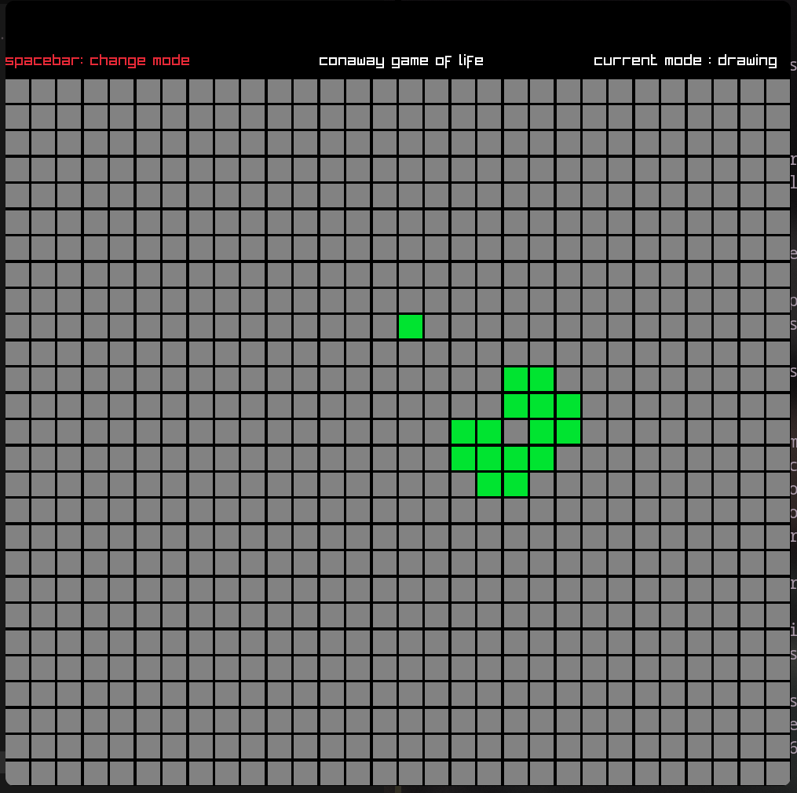

# Game of Life 
This is a simple implimentation of **Conway's game of life** build in C using [raylib]
(https://www.raylib.com/).

"conway's game of life" or simple Life,is a cellural automaton devised by the british mathematician John Horton Conway in 1970.


<p align="center">
##ScreenShort

</p>

##How Does It Works?

the simulation follows four basic rules:

1.**Underpopulation**: A live cell will die if it have less than two neighobours
2.**Overpopulation**: A live cell will die if it have more than three neighobours.
3.**survival**: A live cell will survive with two or three neighobours.
4.**Reproduce**: A dead cell with exact three living neighobours becomes alive.

##Controls 
**Space** : To change mode.
**R** : Restart the simulation.

## Installation 

### Building from source 

To build this project, you need a C compiler and [raylib](https://www.raylib.com/) installed on your system.
- Clone the repository 
```
git clone https://github.com/itz-pranjal/conway-gol-c
```
- Compile 
```
cd conway-gol-c &&  gcc main.c -o gol -lraylib -O3 
```
- Run 
```
./gol
```


